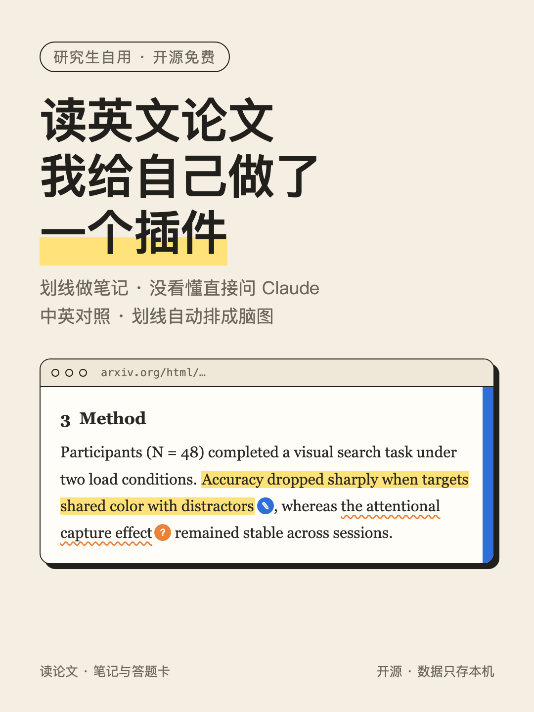

# 读论文 · 笔记与答题卡

一个给读英文论文用的 Chrome 插件：在网页上划线、写笔记、标“没看懂”，直接问 Claude；段落下方对照中文翻译；划线自动排成按章节分组的阅读画布，可以导出到 Obsidian。

所有数据只存在你自己的电脑上（插件只和本机 `127.0.0.1:8765` 通信）。



## 能做什么

- **划线和笔记**：选中文字后弹出小工具条，可以高亮、写笔记、收藏、打标签。有 7 种颜色和 4 种样式（高亮、下划线、波浪线、方框）。下次打开同一篇论文，划线会自动出现。
- **❓ 没看懂 → 问 Claude**：把原句、所在段落和论文相关片段一起发给本机的 Claude Code，回答边生成边显示，之后可以继续追问。弄懂后点“标为已解决”。
- **🌐 对照翻译**：只翻正文段落，表格、图注、公式不翻。滚动到哪里翻到哪里，翻过的段落会缓存。
- **🗺 阅读画布**：划线按“论文 → 章节 → 划线卡”自动排成脑图。单击卡片跳回原文对应的句子。可以拖动、连线、改颜色，一键导出为 Obsidian `.canvas` 文件。
- **右侧抽屉**：本页笔记、全部笔记、待解决、标签筛选，以及“今天读了几篇、各读了多久”。
- **答题卡（可选）**：边读边答预设问题，交给 Claude 对照原文批改。

适用于 arXiv HTML 版、出版社网页全文、知网 HTML 阅读器等普通网页。Chrome 自带的 PDF 查看器里不能划线。

## 安装

需要：macOS / Linux / Windows，Chrome，Python 3.9 或更高版本（不需要额外安装 Python 包）。

**1. 启动本机服务**

```bash
cd server
python3 server.py
```

macOS 也可以直接双击 `server/start.command`。数据默认存放在 `~/读论文笔记/`。

**2. 安装插件**

1. Chrome 打开 `chrome://extensions`，开启右上角的“开发者模式”。
2. 点击“加载已解压的扩展程序”，选择本仓库的 `extension` 文件夹。
3. 把插件固定到工具栏，然后刷新已经打开的网页。

**3. 让“问 Claude”可用（可选）**

先安装 [Claude Code](https://docs.claude.com/en/docs/claude-code)，在终端运行 `claude`，输入 `/login` 登录一次。插件调用的是你自己账号的额度，并且关闭了 Claude 的所有工具，它只回答问题，不会读写你的文件。

**4. 让对照翻译可用（可选）**

任何 OpenAI 兼容接口都可以，例如硅基流动、DeepSeek、OpenAI。启动服务前设置：

```bash
export RN_TRANSLATE_API_BASE="https://api.siliconflow.cn/v1"
export RN_TRANSLATE_API_KEY="你的密钥"
export RN_TRANSLATE_MODEL="Qwen/Qwen2.5-7B-Instruct"   # 可不设
```

## 其他设置

| 环境变量 | 作用 |
|---|---|
| `RN_DATA` | 数据文件夹，默认 `~/读论文笔记` |
| `RN_OBSIDIAN_VAULT` | Obsidian 库路径。设置后，画布导出到库中这篇论文笔记所在的文件夹 |
| `RN_ASK_PERSONA` | 给 Claude 的一句自我介绍，如“我是心理学研一学生，英文一般” |

在数据文件夹里放一个 `reading_lines.json`（格式见 `server/reading_lines.example.json`），抽屉的“今天”页就会按阅读线统计每天读了几篇。

## 数据存放位置

```
~/读论文笔记/
├── web_notes/     每个网页一个 json（原始数据）
├── 网页笔记/        同步出的 Markdown，可以直接放进 Obsidian
├── mindmaps/      画布状态
├── pages/         论文全文缓存（问 Claude 时作为上下文）
└── translations.json
```

## 许可

MIT
